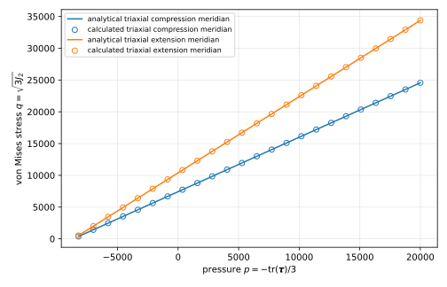

Mohr-Coulomb plasticity
========================

``MAT_PlasticMohrCoulomb`` implements finite-strain Mohr-Coulomb plasticity based on
Kratos's ``HenckyMCPlastic3DLaw``. The elastic predictor uses principal Hencky strain
and Kirchhoff stress. The return mapping follows the Clausen plane, compression-edge,
extension-edge, and apex partition used by Kratos.

The yield function, with principal Kirchhoff stresses sorted as
:math:`\tau_1 \geq \tau_2 \geq \tau_3`, is

.. math::

   f = k \tau_1 - \tau_3 - 2 c(\bar{\varepsilon}^{p})\sqrt{k},
   \qquad
   k = \frac{1+\sin\phi}{1-\sin\phi}.

Independent friction and dilatancy angles provide associative
(:math:`\psi=\phi`) and non-associated (:math:`\psi\neq\phi`) flow. Angles are
specified in radians.

The friction angle must be strictly positive. Its zero-angle limit is the
Tresca criterion, whose yield surface has no hydrostatic apex and is therefore
outside this material's Mohr-Coulomb return-map partition.

Isotropic hardening changes cohesion according to the Kratos-style combined linear
and Voce law

.. math::

   c(\bar{\varepsilon}^{p}) =
   c_0 + H\bar{\varepsilon}^{p}
   + (c_\infty-c_0)
     \left(1-\exp(-b\bar{\varepsilon}^{p})\right).

Here, :math:`\bar{\varepsilon}^{p}` is the accumulated equivalent logarithmic
plastic strain. Its increment is

.. math::

   \Delta\bar{\varepsilon}^{p}
   = \sqrt{\frac{2}{3}\,
     \operatorname{dev}(\Delta\boldsymbol{\varepsilon}^{p})
     :\operatorname{dev}(\Delta\boldsymbol{\varepsilon}^{p})}.

The corresponding input parameters are ``COHESION``,
``ISOTROPIC_HARDENING_MODULUS``, ``EXPONENTIAL_SATURATION_COHESION``, and
``HARDENING_EXPONENT``. Perfect plasticity is obtained with zero linear hardening
and saturation cohesion equal to the initial cohesion.

The material requires ``KINEM nonlinear`` and provides the runtime Gauss-point
outputs ``plastic_strain`` (logarithmic plastic strain),
``accumulated_equivalent_plastic_strain``, and
``accumulated_plastic_volumetric_strain``.

Unlike the current Kratos implementation, 4C accumulates the volumetric plastic
strain and evaluates a finite algorithmic tangent at the apex. These two changes
avoid the unpopulated Kratos output and its zero apex tangent.

4C also selects an apex return only when the edge coordinate belonging to the
current principal-stress sector passes the apex. Kratos currently checks both
edge coordinates globally with a logical ``or`` before identifying the sector,
although its source comment states that both conditions should be satisfied.
That behavior can produce a discontinuous switch between an edge and the apex
for non-associated flow. The sector-specific 4C check removes this discontinuity
and permits the hardening consistency condition to remain solvable.

For robustness of the numerically differentiated material tangent, the
equivalent-plastic-strain consistency equation is solved to an accuracy no
looser than :math:`10^{-3}` times the tangent perturbation, even if the input
``TOLERANCE`` is larger.

Yield-surface verification
--------------------------

The analytical triaxial compression and extension meridians are compared with
numerical roots of the implemented principal-stress criterion below. The open
markers coincide with the analytical curves.

The figure is generated by
``tests/post_processing_test/mohr_coulomb_yield_surface.py``.
